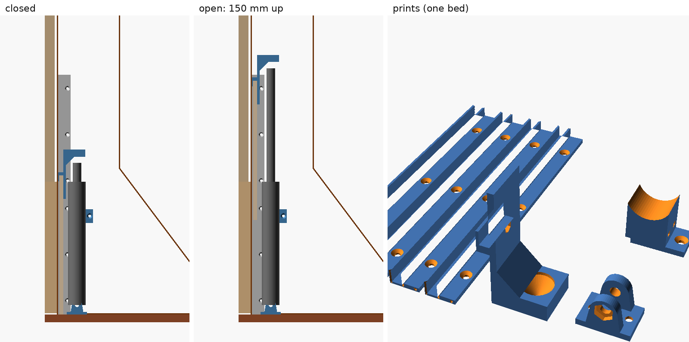
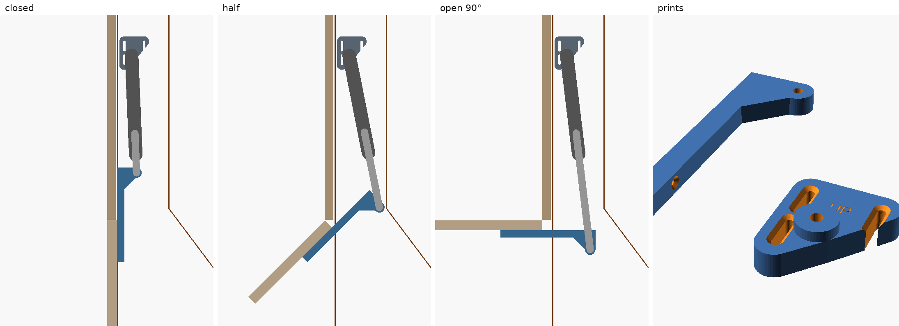
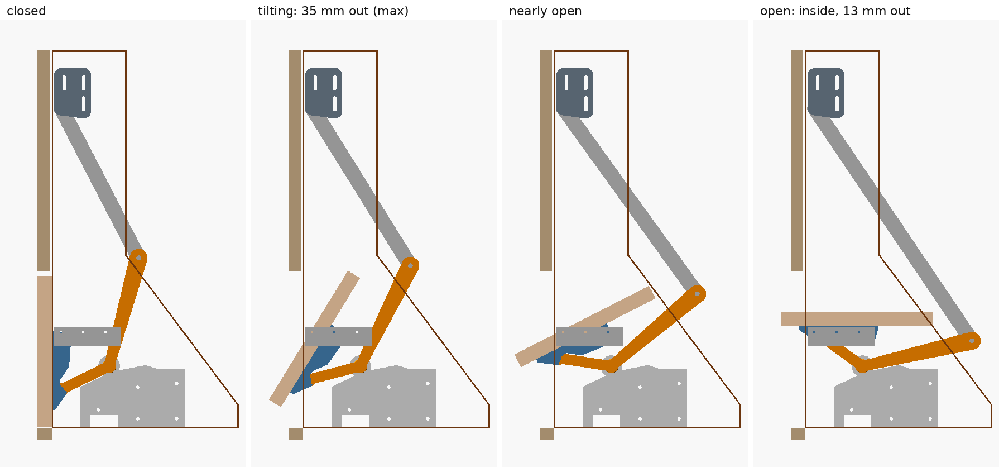
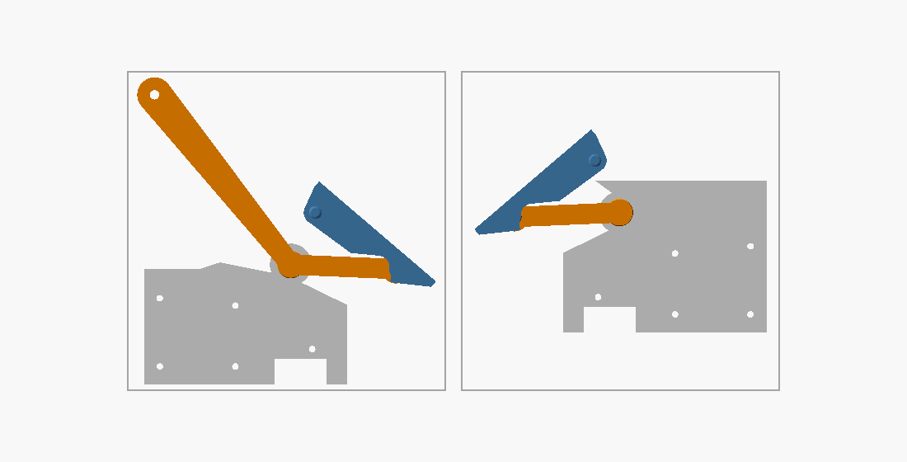
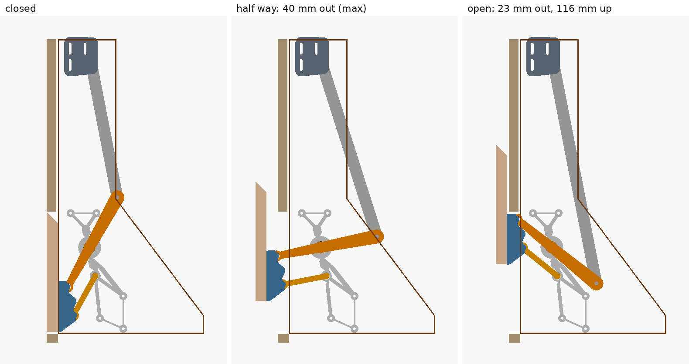
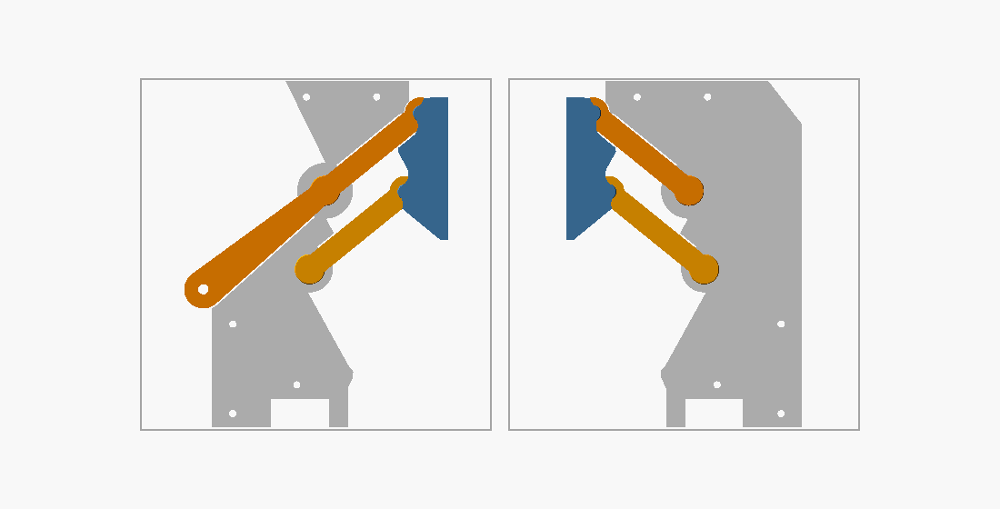

# Doors: 3D-printed parts

Four door types, all for the same robot drawer. Pick one in the simulator; each has its own printed parts here.

| Door | How it opens | Out while moving | Out when open | Printed parts |
|---|---|---|---|---|
| **Lift door** | 6 mm panel slides up 147 mm behind the drawer front | 0 | 0 | 4 channels, saddle, foot, clamp |
| **Flap out** | Flap swings up and out to 90° | 207 mm | 207 mm | Lever, top mount |
| **Up & over** | Tilts up and slides into the cabinet, above the robot | 35 mm | 13 mm | 2 print-in-place modules, 2 tracks, top mount |
| **Parallel lift** | Moves out, then up, stays vertical | 40 mm | 23 mm | 2 print-in-place modules, top mount |

"Out" = how far the door comes in front of the drawer front. All doors use the same 12 V actuator (150 mm stroke, ≈225 mm pin to pin retracted).

## Print settings (all parts)

| Setting | Value |
|---|---|
| Material | PETG: the cabinet is warm and humid |
| Layers | 0.2 mm, first layer also 0.2 mm. The joint gaps are multiples of 0.2 mm |
| Walls / infill | 4 perimeters, 20 %. The pins and the lever need the walls: do not go below 4 |
| Supports / brim | None. Bridges only under the arms, about 14 mm at most on the lever side |
| Elephant-foot compensation | 0.1–0.2 mm |
| Orientation | As exported |
| Bed | 220 × 220 mm |

**Print-in-place joints (up & over, parallel lift):** print `coupon.stl` first. Twist each test joint firmly once and use
the smallest gap that then turns freely. Joint `P` is the big bore at 0.45 mm: if 45 turns but `P` stays stiff, use 0.55.
If your gap is not 0.45, rebuild with `doors/build.sh -D cj=0.35`: the door wedge (below) follows the gap.
After printing, move each module through its full travel a few times until all joints run smoothly. The lever-side joint has the longest bridge, so expect its first twist to be the stiffest. A joint that sticks:
run a 0.4 mm nozzle-cleaning needle around the gap from the bed side, do not force it.

Slicer tips, these matter most for a joint that comes free: random seam (never "rear": pin and ring seams would face each other),
minimum travel for retraction 0.5 mm so it retracts across the gap, PETG at the low end (about 235 °C), outer wall at most 30 mm/s, fan about 50 %.

## How the hinges work

| Part | Design | Why |
|---|---|---|
| Joint | Hourglass pin in a ring with an inner lip, 0.45 mm gap, all flanks 45° | Thickest at the root, where bending peaks. Calculated about 2.2–2.6 × the load of the old diamond pin with the same outside size, and less free tilt (5.5° instead of 7.7°) |
| Bracket underside | Grows out at 45° from the pins | Replaces a 19 mm bridge over the rings, the print's worst spot |
| Wall plate | Rings + screw bosses + ribs, all full height | The ribs follow the load paths (FE-checked). Prints as solid walls |
| Arms | Front arm 18 → 12 mm wide; rear arm 9.5 mm | The front arm carries actuator or rod torque, the rear arm only pull and push |
| Door flange | Wedged 2.25° | The door's weight takes up all joint play, which would lean its top 8 mm out when closed. The wedge cuts this to about 2 mm and still leaves 2 mm to the drawer front when parked |

Printed filament, 4 perimeters (estimate from the slices, old versions at their 3 perimeters):

| Module pair | Old | New |
|---|---|---|
| Parallel lift, left + right | 326 g | 217 g |
| Up & over, left + right | 270 g | 166 g |

**Actuator: rated 50–100 N, with the stall stop set up** (`stall_current` in the ESPHome config, about 0.3 A above the running current).
Calculated pin capacity is about 410–560 N, and a 100 N actuator jammed at one side's door corner puts up to about 400 N on the worst pin, so the stall stop is
what protects the joints (`max_duration` backs it up if the sensor fails). A stronger actuator is not a gain here. The weakest spot in misuse is the door screws:
a 150 N yank on a corner of the open door can pull them out if they work alone (estimated safety factor 0.5–0.75), so **glue the flanges to the door**, see the door steps.
All of this is calculated, not yet broken on the bench.

## Test before you fit the door

No part of this design has been printed yet. These tests decide whether it is sound; stop at the first failure and report it.

| # | Test | Pass |
|---|---|---|
| 1 | `coupon.stl`: one firm twist on each joint | The 0.45 joint and joint `P` turn freely, no cracks |
| 2 | Spare coupon, 0.45 joint: clamp the base tab in a vice, pull the post sideways with a luggage scale until it breaks | Calculated 410–560 N for the pin. Note where it broke. Under 200 N: do not use the design |
| 3 | Module: free all joints. Screw the plate to a board, hold the plate and rock the bracket by hand | Moves through the full travel, no binding, no cracks |
| 4 | Same module on the board: pull the bracket away from the plate with the scale, along the arms, to 200 N for 10 s. That is the worst pin load with a 50 N actuator stalled at one side | No cracks or whitening, still turns freely |

## Lift door

| File | Qty | What |
|---|---|---|
| `lift_channel.stl` | 4 | U-channel, 190 mm. 2 per side, one above the other. Replaces the alu profile |
| `lift_saddle.stl` | 1 | Clip over the panel's top left corner. The actuator rod pushes into its cup |
| `lift_foot.stl` | 1 | Clevis for the actuator's bottom eye, on the tray |
| `lift_clamp.stl` | 1 | Holds the actuator upright on the left cheek (zip tie) |
| `lift-door.scad` | | Source. Customizer: actuator length, rod eye, body diameter |

| Step | What to do |
|---|---|
| 1 | Channels: front edge 2 mm behind the cheek front edge, lower one on the tray, upper one on top of it. A piece of 1.75 mm filament in the end holes lines them up. 3 screws 3.5 × 16 each |
| 2 | Foot: centre 32 mm behind the cheek front edge, 36 mm from the left cheek. 2 screws 4 × 16 |
| 3 | Actuator bottom eye into the foot (M6 bolt + nut). Clamp at 145 mm above the tray, notch over the channel. 2 screws 4 × 16, zip tie round the actuator |
| 4 | Saddle on the panel's top left corner, centre 33 mm from the panel's left edge. M3 × 16 bolt + nut through lip, panel and plate (hidden behind the drawer front) |
| 5 | Panel into the channels. Closed it rests on the tray, the rod tip 3 mm under the cup |

Check (`check_simple.py`): panel rises 147 mm. Saddle 5 mm from the drawer front, 17 mm from the clamp. Parts do not touch.

## Flap out

| File | Qty | What |
|---|---|---|
| `flap_lever.stl` | 1 | Lever on the flap's back, reaches 92 mm above the hinge. Replaces the bent steel L-bracket |
| `flap_mount.stl` | 1 | Actuator top mount on the left cheek, ±8 mm slots |
| `flap.scad` | | Source |

| Step | What to do |
|---|---|
| 1 | Lever on the flap's back: outer face 55 mm from the flap's left edge, lower end 80 mm below the hinge axis. 3 screws 3.5 × 25 |
| 2 | Top mount: bolt 28 mm behind the cheek front edge, 525 mm above the tray. 3 screws 4 × 25 |
| 3 | Actuator: top eye on the mount boss, rod eye on the bay side of the lever pin (M6, washer between) |
| 4 | Retract the actuator fully, slide the mount until the flap just closes, tighten |

Check (`check_simple.py`): stroke 225 → 375 mm, lever arm 60–107 mm, holding force max 21 N.

## Up & over

Like a small garage door. A peg on each door bracket runs in a short track; one arm per side tilts the door up.
Open, the door lies flat inside the cabinet, 137 mm above the tray, above the robot.

| File | Qty | What |
|---|---|---|
| `coupon.stl` | 1 | **Print first.** 3 test joints, 0.35 / 0.45 / 0.55 mm gap, plus big joint `P` |
| `upover_left.stl` | 1 | Left module, with the actuator lever. Printed half open, 206 × 206 mm |
| `upover_right.stl` | 1 | Right module, 197 × 134 mm |
| `upover_track_left.stl`, `upover_track_right.stl` | 1 + 1 | Tracks for the pegs |
| `upover_mount.stl` | 1 | Actuator top mount + rod-eye spacer |
| `upover_template.stl` | 1 | Drill template for plate and track screws |
| `up-over.scad` | | Source |

**Door:** 492 × 202 mm (2 mm lower than the other doors: 6 mm gap under the drawer front). No chamfer needed.

| Step | What to do |
|---|---|
| 1 | Template on the cheek: front edge against the back of the front leg, bottom edge on the tray. Pre-drill the 5 plate holes and 3 track holes (3 mm). Left cheek: turn it over like a page |
| 2 | Modules on the cheeks: 5 screws 4 × 20 each, from the robot side |
| 3 | Tracks over the pegs (slot towards the bay), 3 screws 3 × 16 each. A little grease in the slot |
| 4 | Door: hold it in place, closed. Brackets: bottom edge 23 mm above the door's bottom edge. Polyurethane or epoxy glue on the flange face (sand the PETG first), 3 screws 3.5 × 16 per bracket at 45° from the bay side (pre-drill 2.5 mm through the bracket holes) |
| 5 | Top mount: bolt 13 mm behind the cheek front edge, 428 mm above the tray. 3 screws 4 × 25 |
| 6 | Actuator: rod eye with the printed spacer on the lever (nyloc nut in the hex pocket), top eye on the mount boss |
| 7 | Retract fully, slide the mount until the door is just shut, tighten |

No sync rod: the arms sit at 98 mm height, right over the robot. The door itself keeps both sides in step.

Check (`check_upover.py`): joint gap 0.45 mm, other moving gaps ≥ 1.0 mm, each body one piece. Door ≥ 2.5 mm from the drawer front and from
the docked robot, 2 mm above the tray. Actuator 225 → 375 mm, no dead point, holding force max 39 N.
The peg is now Ø10 mm and its slot runs 3 mm past the open position, so the peg never ends up against the slot's end.

## Parallel lift

The door stays vertical. It moves out, then up on a circle and parks 116 mm higher, only 3.5 mm in front of the drawer front.

| File | Qty | What |
|---|---|---|
| `coupon.stl` | 1 | **Print first.** 3 test joints plus big joint `P` |
| `parallel_left.stl` | 1 | Left module, with the actuator lever. Printed open, 168 × 212 mm |
| `parallel_right.stl` | 1 | Right module, 144 × 212 mm |
| `parallel_mount.stl` | 1 | Actuator top mount + rod-eye spacer |
| `parallel_template.stl` | 1 | Drill template for the plate screws |
| `parallel-lift.scad` | | Source |

**Door:** 492 × 204 mm. **45° chamfer on the top back edge, leave a 1 mm flat at the front.** It lets the door slide past
the drawer front's bottom edge; from the front you do not see it.

| Step | What to do |
|---|---|
| 1 | Template on the cheek (front edge on the back of the front leg, bottom edge on the tray). Pre-drill the 5 holes. Left cheek: turn it over |
| 2 | Left module on, 5 screws 4 × 20 from the robot side |
| 3 | Solid steel square rod 8 × 8 mm into the square hole of the left front arm, 14 mm deep (tight on purpose: file the hole if the rod does not go in). Length = distance between the cheeks − 16 mm (502 → 486 mm) |
| 4 | Right module onto the other end of the rod, then screw it on |
| 5 | Door: hold it closed. Bracket bottom = door bottom edge, outer face = door side edge. Pull the door flat against the flange: the flange is wedged on purpose (see "How the hinges work"), so do not shim it. Polyurethane or epoxy glue on the whole flange face (sand the PETG first), 3 screws 3.5 × 16 per bracket at 45° from the bay side (pre-drill 2.5 mm) |
| 6 | Top mount: bolt 59 mm behind the cheek front edge, 455 mm above the tray. Actuator with the spacer on the lever, as above |
| 7 | Retract fully, slide the mount until the door is flush, tighten |

Check (`check_parallel.py`): joint gap 0.45 mm, other gaps ≥ 1.0 mm, each body one piece. With the door's weight on the joints: top about 2 mm out when closed, 2 mm from the drawer front parked (1.3 mm if your real gap
comes out 0.1 mm tighter than set), 2 mm above the tray. Actuator 225 → 375 mm, holding force max 14 N.

## Reeds (all doors)

| Reed | Where |
|---|---|
| Door closed | Lift: on the tray under the panel. Others: magnet on the back of a bracket's (or the lever's) lower end, reed right behind it |
| Door open | Magnet on the lever tip (lift: on the saddle), reed where it stops. Set it so the door stops before the actuator's own end stop |

ESPHome: no change. Same endstop cover with both reeds.

## Hardware for every door

| Part | Qty |
|---|---|
| Linear actuator 12 V, 150 mm stroke, 50–100 N (see "How the hinges work"), ≈225 mm pin to pin retracted | 1 |
| M6 bolts (eye thickness + 25 mm), nyloc nuts, washers | 2 |
| Countersunk wood screws, see the steps | – |

## Rebuild + check

| Command | What |
|---|---|
| `doors/build.sh` | All STL + `robo-garage-doors_v<version>.zip`. Extra args go to OpenSCAD, e.g. `-D cj=0.35` |
| `python3 doors/check_parallel.py` | Parallel lift: whole travel in 1 % steps (`--quick`: 5 %) |
| `python3 doors/check_upover.py` | Up & over |
| `python3 doors/check_simple.py` | Lift door + flap |
| `python3 doors/render.py` | The pictures in this file |

Needs `openscad`, `zip`, `xvfb-run`; Python `trimesh`, `rtree`, `shapely`, `numpy`, `Pillow`.
